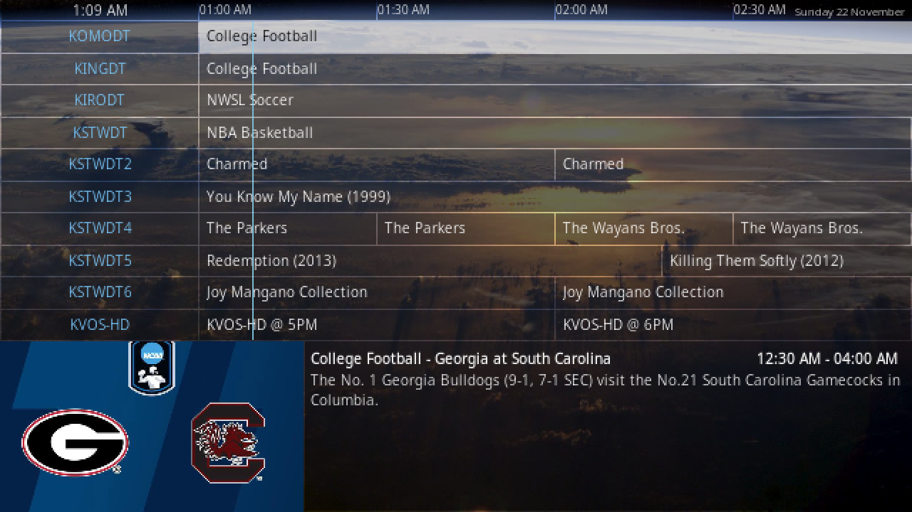
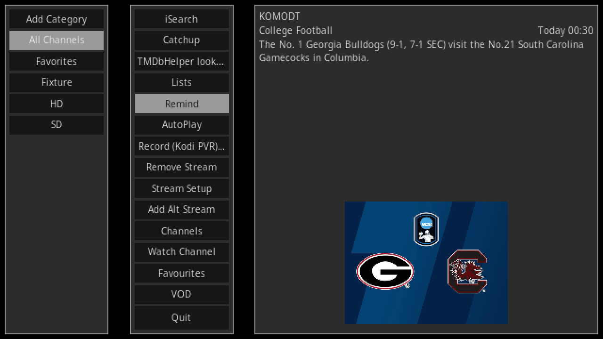
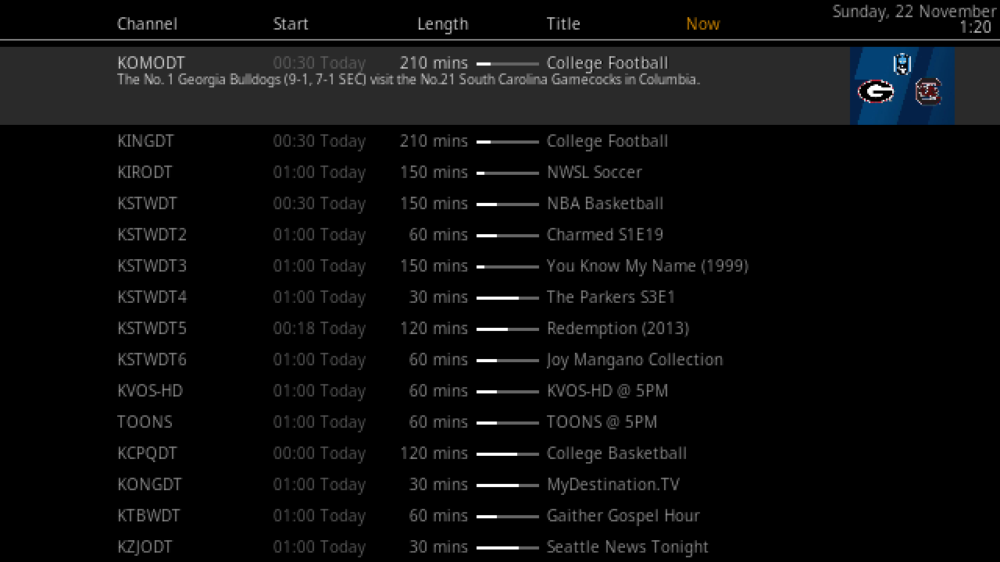
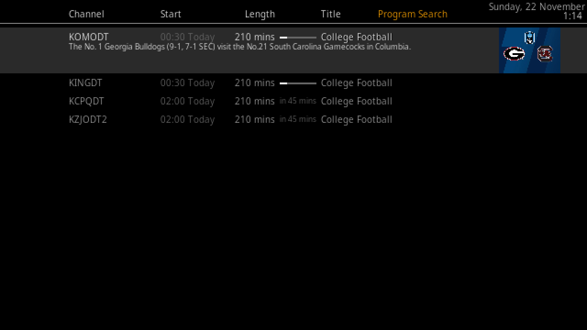
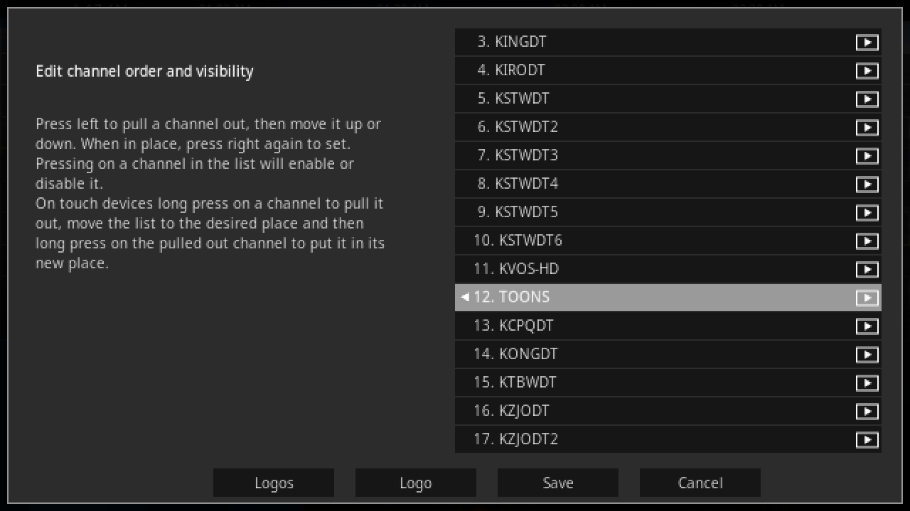

# TV Guide Fullscreen — 0.1.0 Beta

A fullscreen XMLTV programme guide for Kodi: browse what's on, map channels to
streams, search listings, and set reminders or ordinary AutoPlay. This is the
**maintained modernization fork** of primaeval's TV Guide Fullscreen, preserving
its Program add-on and background service. It supplies no TV subscriptions or feeds.

**0.1.0 Beta is available as a direct GitHub prerelease, not through kcook-lab-repo.**
Use the [verified-download installation steps](#installation) below. The beta reuses
independently accepted, bounded Nexus 20.5 core evidence for unchanged code. This
is not stable/full legacy parity, a clean static gate, or current four-version
beta native qualification. See
[Beta scope, evidence and release notes](docs/beta-0.1.0.md).
The bounded beta recommendation is **Nexus 20.5**; Matrix/Omega/Piers beta acceptance
is deferred, with historical evidence only, not fresh beta PASS. This scope decision
supplies neither content rights nor repository admission.

**Repository admission is blocked:** the existing repository controls require a
verified redistribution basis for all bundled material. The inherited artwork
and screenshots remain **unverified**, and owner acknowledgement does not satisfy
that requirement. The owner accepts this uncertainty for the one-time source
GitHub beta only; this supplies no third-party permission or legal clearance.
Correcting the MIT notice did not clear broader artwork rights. Repository
safeguards remain enforced, with no TV Guide catalog listing or Pages promotion.

## Installation

### Direct GitHub beta installer

1. Open the [0.1.0 Beta prerelease](https://github.com/kcook98765/script.tvguide.fullscreen/releases/tag/v0.1.0-beta)
   and download **both** the [installer ZIP](https://github.com/kcook98765/script.tvguide.fullscreen/releases/download/v0.1.0-beta/script.tvguide.fullscreen-0.1.0.zip)
   and [SHA256SUMS](https://github.com/kcook98765/script.tvguide.fullscreen/releases/download/v0.1.0-beta/SHA256SUMS).
   Do not use GitHub's source-snapshot ZIPs as installers.
2. Save both assets together, keep the ZIP's published filename, and run
   `sha256sum -c SHA256SUMS` in that directory. Require
   `script.tvguide.fullscreen-0.1.0.zip: OK`. If verification fails, do not install.
3. Back up your **Kodi profile, TV Guide settings, channel/stream mappings and
   saved reminder/AutoPlay rules**; prefer a separate test profile.
4. In Kodi, use **Add-ons → Install from zip file** and select the verified ZIP.
   If prompted, explicitly consent to Kodi's standard **Unknown sources** setting
   for this trusted ZIP source. If supported source installation is unavailable,
   ask your Kodi administrator; do not bypass policy. **No Kodi Reset is required.**

Installer: **2,137,274 bytes, 322 files**, SHA-256
`da5f38eed4707aa6de9ac7d9648008565ac332f51e93dc6cc5dab6f11f00f82e`.
The frozen reviewed ZIP is unchanged; these source documentation updates are
outside the installer and do not require retagging or rebuilding it.
Other versions remain in the [fork Releases index](https://github.com/kcook98765/script.tvguide.fullscreen/releases).

### Existing repository installer — TV Guide beta is absent

The live [kcook-lab-repo source page](https://kcook98765.github.io/kcook-lab-repo/)
offers [repository.ai.kodi-0.1.1.zip](https://kcook98765.github.io/kcook-lab-repo/repository.ai.kodi-0.1.1.zip).
To install **the existing repository only**:

1. Add `https://kcook98765.github.io/kcook-lab-repo/` in Kodi **File manager → Add
   source**, naming it `kcook-lab-repo`.
2. Use **Add-ons → Install from zip file** to select the repository installer
   listed at that source. If prompted, explicitly consent to Kodi's standard
   **Unknown sources** setting for this trusted ZIP source.
3. **Install from repository → kcook-lab-repo** browses its existing compatible
   add-ons. It does **not** offer TV Guide Fullscreen 0.1.0 Beta.

The route **Install from repository → kcook-lab-repo → Program add-ons → TV Guide
Fullscreen** is pending genuine TV Guide admission and listing for your Kodi lane,
not a current beta installation route. Only after that could repository updates
follow your **Kodi update and origin settings**; this does not establish automatic
updates or migration for an existing ZIP installation.

### Updating and first use

Back up your **Kodi profile, TV Guide settings, channel/stream mappings and saved
reminder/AutoPlay rules** first; prefer a separate test profile. Numeric manifest
version **`0.1.0` sorts above `0.0.446~alpha1`**. A normal in-place update is the
intended route; no Kodi profile Reset is required. Actual Alpha-to-beta upgrade,
migration, obsolete-file pruning and ZIP-installed automatic updates have **not**
been verified. No native upgrade test was performed for this beta; original
profiles were untouched by preparation. Installing the existing repository does
not itself make TV Guide available or guarantee an existing ZIP install will auto-update.

Keep the official Kodi repository enabled for required dependencies. Configure
a current **XMLTV file/URL** and matching **M3U stream mappings** in TV Guide's
settings; use only sources you are entitled to access. Allow the initial import
to finish. Launch through **My add-ons → Program add-ons → TV Guide Fullscreen →
Info → Run**. Keep the background service with explicit consent; do not execute
`service.py` manually. Ordinary **Stop** returns from playback to the guide.
Changing an XMLTV offset alone may reuse cached programmes: see the
[offset/refresh cautions](docs/xmltv-source-offsets.md) before forcing a refresh
that could affect channel-associated rules.

## Preparation history — 2026-11-21

The original unpublished private 0.1.0 ZIP remains historical, SHA-256
`0b25379c9eb71bd6e9014704114e5b3a7104c6fbbd9e209a97f5e189f7464492`.
Its notice-only successor added the missing OrderedDict backport MIT notice in
[THIRD-PARTY-NOTICES.txt](THIRD-PARTY-NOTICES.txt), superseding it for review and
subsequent publication. All 321 original payloads, including all 45 runtime Python
files, are unchanged; the notice is the sole added installer member. The owner
authorized the same numeric `0.1.0` because the original candidate was unpublished.
The preparation and successor reviews did not themselves publish a release or
grant rights/repository admission. See the [dated successor disclosure](docs/beta-0.1.0.md#notice-only-successor).

## Required dependencies

All six manifest declarations remain required, not bundled optional extras:

| Dependency | Minimum version |
| --- | --- |
| `xbmc.python` (provided by Kodi) | `3.0.0` |
| `script.module.requests` | `2.31.0` |
| `script.module.dateutil` | `2.8.2` |
| `script.module.pytz` | `2023.3.0+matrix.1` |
| `script.module.pil` | `5.1.0` |
| `script.module.beautifulsoup4` | `4.12.2` |

Kodi must install/enable suitable official modules; a listing in a catalog is not
installed-state proof. [Official pytz](docs/official-pytz.md) replaces the removed
vendor copy. **No bundled pytz or VPN Manager integration.** Manage VPN connectivity
independently through Kodi, the OS or your network; stale VPN settings are ignored
and untouched. This is not a VPN-security guarantee. See
[VPN removal scope](docs/vpn-manager-removal.md).

## Features and optional integrations

- Fullscreen/Quick guide, programme details, On Now, title/channel search and channel
  management; primary, alternative and automatic-fallback mapped playback.
- Reminders and ordinary AutoPlay, source/channel-scoped event identities and
  selective cancellation; additive M3U updates and source-aware XMLTV caching.
- XMLTV source offsets, optional XMLTV/URL logos, passive guide styling, safe JSON
  image matches, closed-catalog action customization and typed media/folder mappings.
  See the [feature inventory](docs/modernization-status.md#feature-inventory).
- Internal search requires no extra add-on. Optional [TMDbHelper lookup](docs/metadata-search.md)
  needs an installed/enabled compatible `plugin.video.themoviedb.helper` with its
  own dependencies/access/setup; it is not full ExtendedInfo or automatic plot/art replacement.
- Optional [Kodi PVR recording/timers](docs/recording-pvr.md) need a capable,
  configured recording backend and enabled PVR client; future scheduling also
  needs its EPG. XMLTV/M3U or IPTV Simple alone is not a recording backend.

## Current evidence and known limitations

The accepted private disposable **Nexus 20.5** campaign used exact `cc411d9` code:
clean GUI ZIP installation with official dependencies; direct/plugin moving
frames (including exact-source reused evidence); explicit alternative and
automatic fallback; Stop; reminder/AutoPlay creation and selective cancellation
preserving unrelated rules; saved reminder restart persistence; actual service
startup work; graceful exits status 0. The beta preparation changed metadata/docs
and added a notice, not behavior, so that evidence is reused. **It is not native
installation of the new 0.1.0 ZIP.**

- **Audio UNTESTED**, accepted beta limitation: clips were video-only. Optional
  timed reminder delivery and actual AutoPlay firing were **not observed**.
- Automatic fallback can start the alternative while Kodi's original failure
  dialog remains visible. Logs are **non-clean**, including caught optional-control
  diagnostics and audio warnings; no blanket harmless-error claim.
- Matrix **19.4** native evidence is historical; static Matrix **19.5** is distinct.
  The historical Matrix crash is unresolved. Omega **21.3** native evidence is
  historical. Piers **22.0 RC2** is historical preview evidence, not final Kodi 22
  qualification; foreground/input limits and plugin EOF uncertainty remain.
  No all-platform testing claim is made.
- The inherited integrated static gate is **FAIL**: latest types-only counts are
  **605/605/605/578** (Matrix/Nexus/Omega/Piers); three locale errors per lane
  remain. No full gate rerun was performed for preparation. All 69 catalogs are retained.
- Third-party skins, external players, provider/catchup templates, legacy recording
  and FFmpeg/external AutoPlayWith parity remain incomplete or limited. Scheduler
  recurrence horizons, collisions and in-flight cancellation have limits. No new
  external-player branch, provider feature or settings-refresh redesign is implied.

## Screenshots

Existing actual Nexus 20.5 captures, Default TV Guide skin, no playback. They show
development UI, not proof of every beta feature or the published Alpha 1 UI.

## Alpha 1 download and installation

The existing public prerelease remains [0.0.446 Alpha 1](https://github.com/kcook98765/script.tvguide.fullscreen/releases/tag/v0.0.446-alpha1):
[installer ZIP](https://github.com/kcook98765/script.tvguide.fullscreen/releases/download/v0.0.446-alpha1/script.tvguide.fullscreen-0.0.446.alpha1.zip)
and [SHA256SUMS](https://github.com/kcook98765/script.tvguide.fullscreen/releases/download/v0.0.446-alpha1/SHA256SUMS).
Its immutable tag `v0.0.446-alpha1` points to
`fc2f021ef6edc8c957e1ca91bfaa024d17c5f510`; manifest `0.0.446~alpha1` and asset
`script.tvguide.fullscreen-0.0.446.alpha1.zip` are unchanged. Installer SHA-256:
`dd10ec02c5a3e9c8f133c87c3cc0ac1806a650473cad7ef877554346daa903e7`.
See [historical Alpha installation and qualification](docs/alpha-installation.md).
Those results do not establish current beta acceptance or upgrade-file pruning.

## Feedback, attribution and license

Report problems to [this fork's issues](https://github.com/kcook98765/script.tvguide.fullscreen/issues)
with source/version, Kodi build/platform, expected/actual result and minimal
steps using safe synthetic data. Remove tokens, credentials, private feed/programme
details, endpoints and profile paths from excerpts; never upload raw settings,
databases, private screenshots or unredacted logs. See the [changelog](changelog.txt).

Based on [primaeval's TV Guide Fullscreen](https://github.com/primaeval/script.tvguide.fullscreen),
Tommy Winther's (twinther) TV Guide, FTV Guide/Thomas Geppert (bluezed), and
Midraal's fork. Thanks to iainmacleod, im85288, RayW1986, andy, Zomboided, tycoo,
kjb86, Doctor-Eggs and the other credited contributors. Original provider,
contributors, source notices and upstream history are preserved; no upstream
endorsement is implied. [LICENSE.txt](LICENSE.txt) contains GNU GPL v2; source
notices permit **GPL v2 or later**. This software comes without warranty.
The separate [third-party notice](THIRD-PARTY-NOTICES.txt) preserves Raymond
Hettinger's OrderedDict MIT terms; the distinct Marti Raudsepp 2010 MIT notice
remains embedded unchanged in `pyaes.py`.
