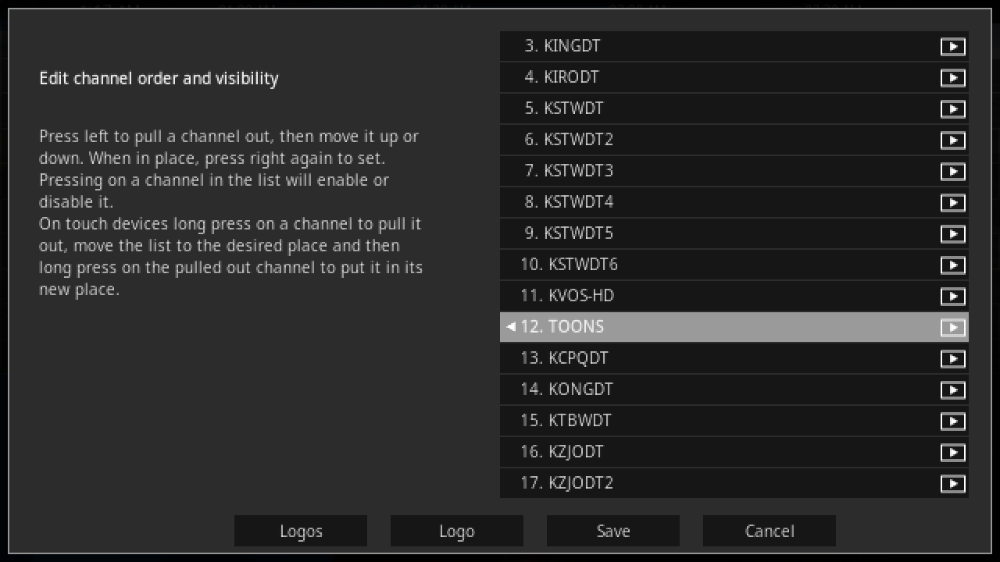

# TV Guide Fullscreen — release and qualification history

This preserves the technical and release detail formerly in the README. Dated
assessments describe their original checkpoint, not blanket current acceptance.
Use the [end-user README](../README.md) for setup and present availability.
No native run, static gate or package rebuild was performed for this relocation.

## 0.1.2 Beta maintenance update

[0.1.2 Beta](beta-0.1.2.md) changes the four Stream Setup visibility predicates
per skin from Kodi's obsolete `StringCompare` condition to `String.IsEqual`.
[PR #81](https://github.com/kcook98765/script.tvguide.fullscreen/pull/81) corrected
Default, Dark and CatBar. Control IDs, focus routing, layouts, runtime Python,
six dependency declarations, artwork and licensing are unchanged from 0.1.1.
The focused regression covers all twelve predicates. The Matrix 19.4 startup
fault remains unclassified and is tracked separately as
[#82](https://github.com/kcook98765/script.tvguide.fullscreen/issues/82).

## Historical 0.1.1 Beta identity and publication

The published [v0.1.1-beta prerelease](https://github.com/kcook98765/script.tvguide.fullscreen/releases/tag/v0.1.1-beta)
is an **artwork-only successor; runtime unchanged**. Original geometric icon/fanart
replace the Earth images; four promotional screenshots are omitted. The retained
channel-management capture is byte-identical. See [0.1.1 notes](beta-0.1.1.md) and
[artwork provenance](artwork-provenance.md).

- [Installer ZIP](https://github.com/kcook98765/script.tvguide.fullscreen/releases/download/v0.1.1-beta/script.tvguide.fullscreen-0.1.1.zip)
  and [SHA256SUMS](https://github.com/kcook98765/script.tvguide.fullscreen/releases/download/v0.1.1-beta/SHA256SUMS):
  **1,318,170 bytes, 318 files**, SHA-256
  `76533fcb570cd813e2deb885c919b59eea21171c6ce344d5a40ef5d8fba287b9`.
- Source/tag target `f936c0a514e0de126e62e24fd3d24b66b0c74097`, tree
  `c6d014c332f6d24b219f4976518dcf2221ae6a88`. All 45 runtime Python files are
  unchanged from the preceding Beta. Documentation is outside the installer.
- **Current three-lane publication:** Matrix **19.x**, Nexus **20.x** and Omega
  **21.x** catalogs publish `0.1.1` and reference the identical approved ZIP through
  the unchanged repository installer. Codex's supplied final anonymous verification
  passed at **2026-11-22 11:11:14 UTC**: 50 positive URL checks (HEAD/GET for the 49
  files and root) and four excluded 404s on the 49-file site, Pages
  `bf76b1c407d48a3d7b8e93fede67bbff04b7cf6e`, canonical site SHA-256
  `31e5f98ca19e12e1f42ba7a1f0bde719f25ec24f7b976c990012c04b84bb9de2`.
  Its parent is the previous Pages commit below; Nexus/Omega/Piers catalog bytes
  and existing packages/installers/sidecars are unchanged. Piers **22.x** is excluded.
  These are existing Codex publication observations, not HTTP or native tests run
  for this documentation update; no new native acceptance follows.
- **Previous Nexus/Omega publication checkpoint:** Nexus **20.x** and Omega **21.x**
  catalogs published `0.1.1` with the same ZIP. Codex's anonymous verification then
  recorded 47 positive HTTP responses and four excluded 404 checks on the 46-file
  site, Pages `f73bc7567083cdb39cb9cc049ac1795c2606327f`, digest
  `203722a6dde39239a1ca72bfce8195b573ba3ff6acdb3662b7d975d5d81041a5`.
  These are supplied publication records, not checks rerun for this documentation.
  Matrix was not yet published at that previous checkpoint; the subsequent
  three-lane publication is recorded above. Direct release ZIP availability is
  independent of repository admission. Catalog checks are not
  native repository UI or upgrade acceptance, or blanket content-rights certification.

## Historical 0.1.0 Beta — existing direct installer

The public [v0.1.0-beta release](https://github.com/kcook98765/script.tvguide.fullscreen/releases/tag/v0.1.0-beta),
[installer ZIP](https://github.com/kcook98765/script.tvguide.fullscreen/releases/download/v0.1.0-beta/script.tvguide.fullscreen-0.1.0.zip)
and [SHA256SUMS](https://github.com/kcook98765/script.tvguide.fullscreen/releases/download/v0.1.0-beta/SHA256SUMS)
remain unchanged: **2,137,274 bytes, 322 files**, SHA-256
`da5f38eed4707aa6de9ac7d9648008565ac332f51e93dc6cc5dab6f11f00f82e`.
It is not listed in kcook-lab-repo. Source/tag target
`c19f256333efbe7af12418312f17e00f99792dc2`, tree
`b51337779aa4a07dec43ac74530d95954ea5f16c`; see the unchanged
[historical installation, evidence and capture history](beta-0.1.0.md).
Neither this release nor Alpha 1 is rebuilt or retagged by the README change.

### Preparation history — 2026-11-21

The original unpublished private `0.1.0` ZIP remains historical, SHA-256
`0b25379c9eb71bd6e9014704114e5b3a7104c6fbbd9e209a97f5e189f7464492`.
Its notice-only successor added the missing OrderedDict backport MIT notice in
[THIRD-PARTY-NOTICES.txt](../THIRD-PARTY-NOTICES.txt), superseding it for review
and subsequent publication. All 321 original payloads, including all 45 runtime
Python files, are unchanged; the notice is the sole added installer member. The
owner authorized the same numeric `0.1.0` because the original was unpublished.
Preparation and successor reviews did not themselves publish or grant rights or
repository admission. See the [dated successor disclosure](beta-0.1.0.md#notice-only-successor)
for private candidate identities, license sources, audit and negative-control detail.

## Historical Alpha 1 download and installation

The existing public prerelease remains
[0.0.446 Alpha 1](https://github.com/kcook98765/script.tvguide.fullscreen/releases/tag/v0.0.446-alpha1):
[installer ZIP](https://github.com/kcook98765/script.tvguide.fullscreen/releases/download/v0.0.446-alpha1/script.tvguide.fullscreen-0.0.446.alpha1.zip)
and [SHA256SUMS](https://github.com/kcook98765/script.tvguide.fullscreen/releases/download/v0.0.446-alpha1/SHA256SUMS).
Immutable tag `v0.0.446-alpha1` points to
`fc2f021ef6edc8c957e1ca91bfaa024d17c5f510`; manifest `0.0.446~alpha1` and actual
asset `script.tvguide.fullscreen-0.0.446.alpha1.zip` remain unchanged. SHA-256:
`dd10ec02c5a3e9c8f133c87c3cc0ac1806a650473cad7ef877554346daa903e7`.
See [historical Alpha installation and qualification](alpha-installation.md).
Those results do not establish current Beta acceptance or upgrade-file pruning.

## Modernization and native qualification checkpoints

The [feature inventory and dated qualification records](modernization-status.md#feature-inventory)
retain earlier Alpha/Alpha2 improvements, native component reuse, exact sources,
warnings, negative controls and static failures. The [continued development record](alpha2-development.md)
and [historical 0.1.0 report](beta-0.1.0.md) remain unmodified.

The README's technical summary covered fullscreen/Quick guide, programme details,
On Now, title/channel search and channel management; primary, alternative and
automatic-fallback mapped playback; reminders and ordinary AutoPlay with
source/channel-scoped event identities and selective cancellation; additive M3U
updates and source-aware XMLTV caching. XMLTV offsets, optional XMLTV/URL logos,
passive guide styling, safe JSON image matches, closed-catalog action customization
and typed media/folder mappings remain documented in that inventory.

Internal search needs no additional add-on. Optional [TMDbHelper lookup](metadata-search.md)
requires installed/enabled compatible `plugin.video.themoviedb.helper` and its
dependencies/access/setup; it is not full ExtendedInfo or automatic plot/art
replacement. Optional [PVR recording/timers](recording-pvr.md) require a capable,
configured backend and enabled client, plus its EPG for future scheduling.
XMLTV/M3U or IPTV Simple alone is not a recording backend. Required official
[pytz](official-pytz.md) replaces the removed vendor copy; all six dependency
floors remain in the [README](../README.md#required-dependencies). No VPN Manager
integration remains; stale settings are ignored and untouched, not migrated.
Manage VPN connectivity independently; [removal scope](vpn-manager-removal.md)
is not a VPN-security guarantee.

### Broader accepted Nexus code evidence — reused

The private disposable **Linux Nexus 20.5** campaign used exact accepted source
`cc411d933a269d4cba080a3bdf646b5eddc71e22`: clean GUI ZIP installation with official
dependencies; direct/plugin moving frames (including exact-source reused evidence);
explicit alternative and automatic fallback; Stop; reminder/AutoPlay creation and
selective cancellation preserving unrelated rules; saved reminder restart
persistence; actual service startup work; graceful exits status 0. The successor
changes artwork and metadata/docs, not runtime behavior, so that evidence is
reused. It is **not new 0.1.1 Nexus native installation, upgrade or repository UI
acceptance**. Earlier blanket README statements that no 0.1.1 native installation
had occurred and that every other Beta lane was deferred are superseded by the
finite Matrix/Omega evidence below, not by a new Nexus run.

### Existing current-package Matrix/Omega smoke — reused

Codex's existing exact-0.1.1 Matrix **19.4** and Omega **21.3** core smoke supports
only its finite Linux scope, not full legacy parity or exhaustive platform support.
The reassessed Matrix record covers native clean GUI installation with official
dependencies, populated guide/navigation, moving owned local video, Stop/guide
return, close/reopen, actual background update and normal exit 0. All 318 installed
members matched the exact ZIP; stopped-profile double-read and seven SQLite
integrity checks passed. Seeded synthetic preferences bounded setup effort; no
code/database was seeded and no GUI-settings-edit result is claimed. No new native
observation is made here. Matrix native **19.4** remains distinct from static **19.5**.
The finite current Omega smoke likewise does not replace the broader Nexus feature
evidence or qualify audio, optional integrations, upgrades or repository UI.

### Historical crashes and current scope

The owner reports repeated older-version crashes across multiple devices, not just
Lab, and explicitly accepts that historical risk. The historical Matrix crash
remains unresolved history: no root cause, fix or reproduction is claimed. Codex's
new reassessment corrects the earlier inference of a current-package blocker from
history/shared runtime identity; it was not established by a current 0.1.1 failure
or demonstrated causal link. The old blocked/deferred assessments remain retained,
not retroactively rewritten. Historical risk acceptance alone would not waive a
genuine current failure. See [dated native records](modernization-status.md#historical-alpha-1-qualification-and-prepublication-record--21-november-2026-utc).

Historical Piers **22.0 RC2** observations are preview-only, not final Kodi 22
qualification; foreground/input limits and plugin EOF uncertainty remain. The
earlier historical Omega record is also retained, alongside later finite smoke.
No all-platform claim follows from any of these results.

### Retained limitations and static diagnostics

- **Audio UNTESTED**: accepted Beta limitation; the clips were video-only. Optional
  timed reminder delivery and actual AutoPlay firing were **not observed**.
- Automatic fallback can start an alternative while the original failure dialog
  remains visible. Logs are **non-clean**, including caught optional-control
  diagnostics and audio warnings; no blanket harmless-error claim.
- Inherited integrated static gate **FAIL**: latest types-only counts
  **605/605/605/578** (Matrix/Nexus/Omega/Piers); three locale errors per lane
  remain. All 69 catalogs are retained. No full gate rerun occurred for preparation
  or this documentation. All six stages remain distinct: syntax, manifest, paths,
  package, types and official checker; saved warnings and negative diagnostics
  are not converted to PASS. See [historical static details](beta-0.1.0.md#staticfocused-scope).
- Third-party skins, external players, provider/catchup templates, legacy recording
  and FFmpeg/external AutoPlayWith parity remain incomplete or limited. Scheduler
  recurrence horizons, collisions and in-flight cancellation have limits. No new
  external-player branch, provider feature or settings-refresh redesign is implied.

## Update and cache cautions

Numeric manifest `0.1.1` sorts above `0.1.0` and `0.0.446~alpha1`; a same-ID in-place
update is intended, not Reset. Alpha-to-Beta upgrade, migration, obsolete-file
pruning and ZIP-origin automatic updates remain unverified, including removal of
the four omitted screenshots from existing installations. Repository updates
follow Kodi's update/origin settings. Original profiles were untouched by package
preparation. Changing XMLTV offsets alone may reuse cached programmes; see
[offset/refresh cautions](xmltv-source-offsets.md) before forcing refreshes that
could affect channel-associated rules. Use the README's single backup instruction.

## Retained screenshot and artwork provenance

Owner-authored actual Nexus **20.5** channel-management capture, Default TV Guide
skin, no playback; exact published 0.1.0 bytes. Ordinary channel labels/UI had no
separately identified artwork blocker in Codex's individual visual review. It is
not a new capture or proof of every Beta feature. Four other promotional captures
were omitted, not replaced or simulated. Their capture history remains in the
[historical 0.1.0 notes](beta-0.1.0.md) and immutable published source/release;
see [per-image dispositions](artwork-provenance.md).

## Attribution and licenses retained

Based on [primaeval's TV Guide Fullscreen](https://github.com/primaeval/script.tvguide.fullscreen),
Tommy Winther's (twinther) TV Guide, FTV Guide/Thomas Geppert (bluezed), and Midraal's
fork. Thanks to iainmacleod, im85288, RayW1986, andy, Zomboided, tycoo, kjb86,
Doctor-Eggs and all other credited contributors. Original provider, source notices,
contributors and upstream history remain; no upstream endorsement is implied.
[LICENSE.txt](../LICENSE.txt) contains GNU GPL v2; source notices permit **GPL v2
or later**, without warranty. The [third-party notice](../THIRD-PARTY-NOTICES.txt)
preserves Raymond Hettinger's OrderedDict MIT terms; Marti Raudsepp's distinct 2010
MIT notice remains embedded unchanged in `pyaes.py`.
